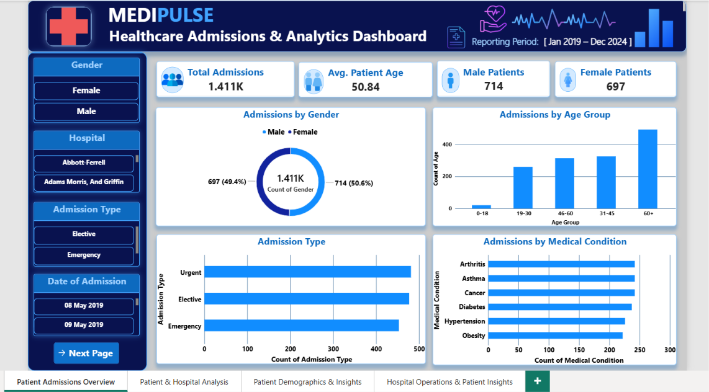
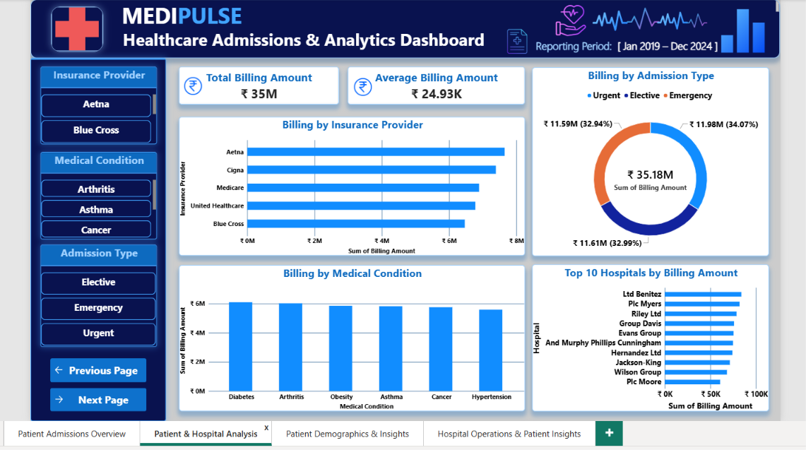
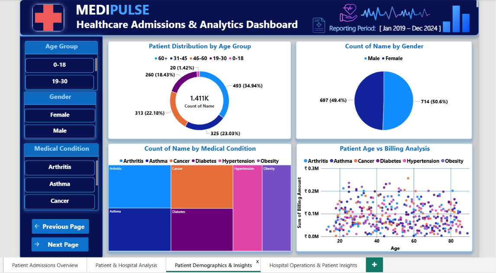
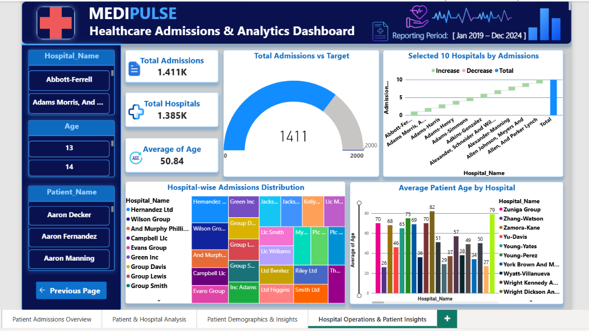

# MediPulse – Healthcare Admissions & Analytics Dashboard

**Healthcare Data Analytics | Excel | Power Query | Power BI | DAX**

MediPulse is a healthcare data analytics project developed to analyse patient admissions, demographics, billing information, and hospital operations using interactive Power BI dashboards.

---

## 📊 Dashboard Previews

### Dashboard 1 – Patient Admissions Overview

### Dashboard 2 – Patient & Hospital Analysis

### Dashboard 3 – Patient Demographics & Insights

### Dashboard 4 – Hospital Operations & Patient Insights

---

## 📌 Project Overview

MediPulse demonstrates the complete healthcare data analytics workflow, from raw dataset exploration and data cleaning to data modelling, DAX calculations, and interactive dashboard development.

The project transforms raw healthcare data into meaningful insights to support the understanding of patient admission patterns, demographics, billing, and hospital operations.

## 🎯 Project Objectives

- Analyse patient admission patterns.
- Understand patient demographics by age group and gender.
- Explore medical conditions and admission types.
- Analyse billing amounts by insurance provider and hospital.
- Examine hospital-wise admissions and patient information.
- Develop interactive dashboards for data-driven analysis.

## 📂 Dataset Information

**Dataset Source:** [Healthcare Dataset – GitHub](https://github.com/anagharithunMS/Python-Analysis-on-Healthcare-dataset)

The original dataset contains 2,000 records and 15 columns covering patient details, admission dates, medical conditions, hospitals, insurance providers, billing, medications, and test results.

### Dataset Summary

| Dataset | Records |
|---|---:|
| Original Raw Dataset | 2,000 |
| Cleaned Healthcare Dataset | 1,411 |
| Patient Dataset | 1,411 |
| Hospital Dataset | 1,385 |

The cleaned healthcare dataset contains 1,411 records after removing 589 records during the cleaning process.

## 🛠️ Tools & Technologies

- **Microsoft Excel** – Data exploration, initial checks, and cleaning.
- **Power Query** – Data transformation and preprocessing.
- **Power BI** – Data modelling, analysis, and dashboard development.
- **DAX** – Calculated columns and analytical measures.

## 🧹 Data Cleaning & Preprocessing

The raw healthcare dataset was reviewed and cleaned using Microsoft Excel and Power Query.

Key activities included:

- Imported and reviewed the raw healthcare dataset.
- Checked blank values across the dataset columns.
- Identified and handled records with missing information.
- Checked duplicate records across all available columns.
- Standardised patient names using the `PROPER()` function.
- Standardised gender values such as `M`, `F`, `male`, and `female`.
- Standardised blood type and medical condition entries.
- Checked date fields and data consistency.
- Loaded the cleaned dataset into Excel for further analysis.

**Final cleaned dataset: 1,411 records and 15 columns.**

## 🗂️ Data Modelling

Created separate patient and hospital datasets to organise the healthcare data for Power BI analysis.

### Patient Dataset

Contains:
- Admission_ID
- Patient_Name
- Age
- Hospital_ID

### Hospital Dataset

Contains:
- Hospital_ID
- Hospital_Name

### Main Healthcare Dataset

Contains patient admission, medical, hospital, insurance, billing, and treatment-related information.

Created relationships using `Hospital_ID` between the hospital table and the patient and main healthcare datasets.

## 📐 DAX & Calculations

Used DAX to support analytical calculations and dashboard reporting.

Examples include:

- Total Patient Admissions
- Average Patient Age
- Admission Target
- Patient Age Group

These calculations support KPI cards, charts, and hospital-level analysis.

## 📈 Dashboard Details

### 1. Patient Admissions Overview

Provides an overall view of admissions, average patient age, male and female patient counts, and admission patterns by gender, age group, admission type, and medical condition.

### 2. Patient & Hospital Analysis

Analyses healthcare billing information by insurance provider, admission type, medical condition, and selected hospitals.

### 3. Patient Demographics & Insights

Explores patient distribution by age group, gender, and medical condition, along with patient age versus billing analysis.

### 4. Hospital Operations & Patient Insights

Provides hospital-level insights through total admissions, total hospitals, average patient age, admissions versus target, selected hospital admissions, hospital-wise distribution, and average patient age by hospital.

## 🔍 Key Project Outcomes

- Cleaned and transformed raw healthcare data.
- Organised patient and hospital information into separate datasets.
- Established data relationships in Power BI.
- Developed DAX calculations and measures.
- Created four interactive Power BI dashboard pages.
- Analysed patient demographics, admissions, billing, and hospital operations.

## 👨‍💻 Author

**Luther Benny**

Currently upskilling in AI-Driven Data Analytics through Entri Academy.

**Skills:** Excel | SQL | Power BI | Python | Data Analytics

---

⭐ If you find this project useful, feel free to explore the repository and share your feedback.
